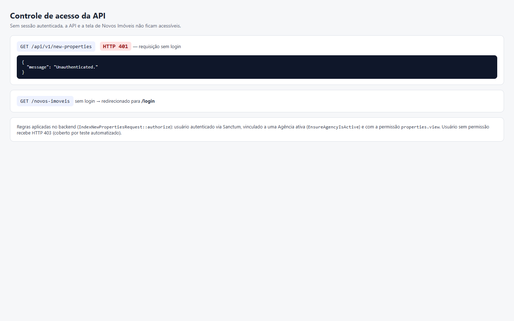
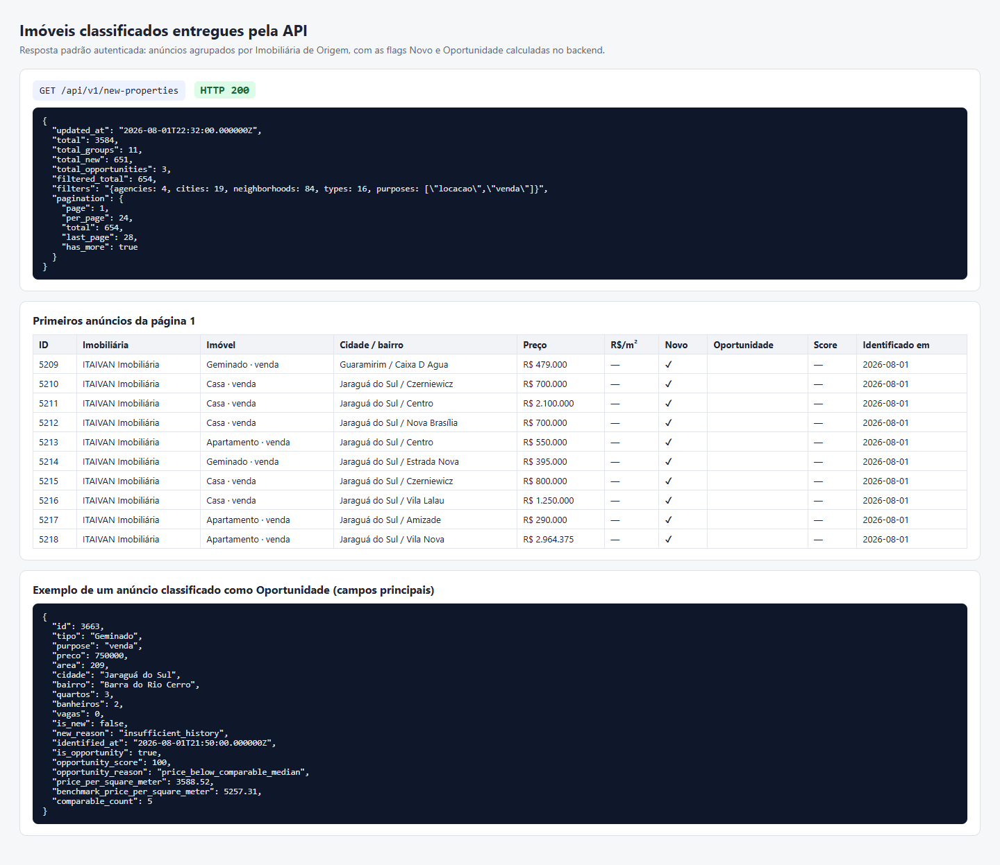
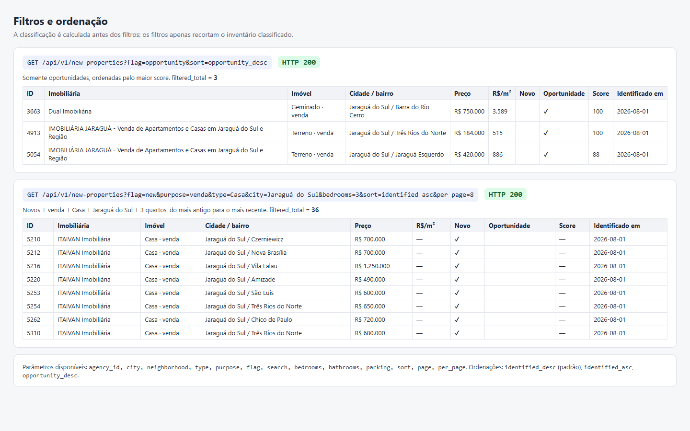
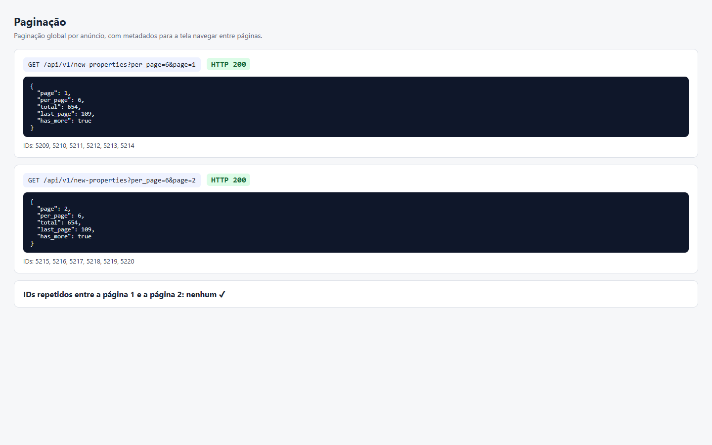
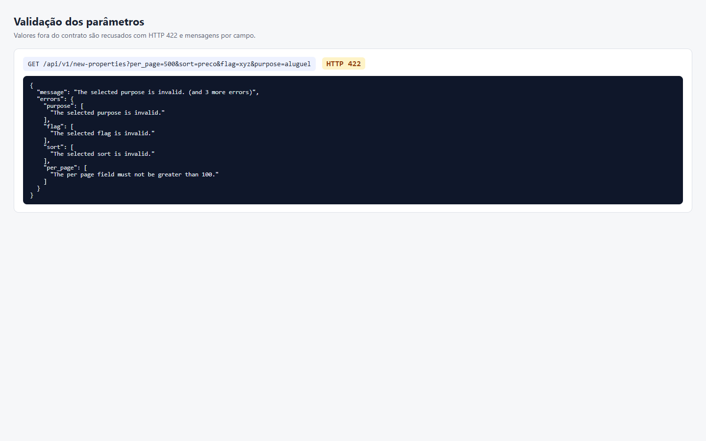
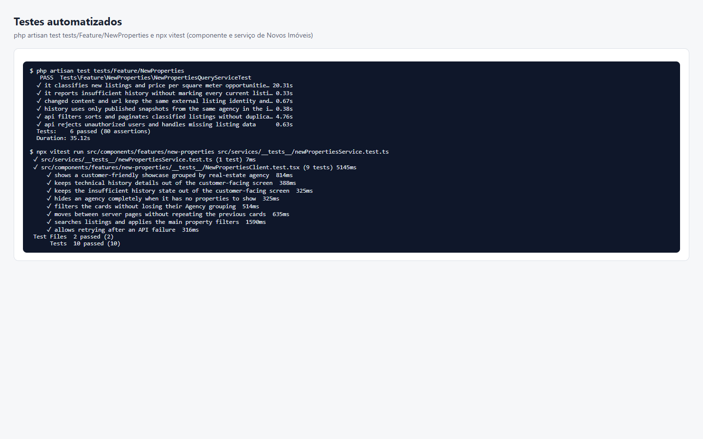

# Evidências — API para Consulta de Novos Imóveis e Oportunidades

**Entrega:** 08/10/2026

**Descrição da tarefa:** criar a API que entrega os imóveis classificados para a tela, com filtros, ordenação, paginação e controle de acesso.

Capturas feitas em 08/10/2026 com o sistema rodando localmente (Laravel Sail + Next.js), a base PostgreSQL restaurada do backup e um usuário de teste autenticado. As respostas mostradas são as respostas reais da API; os números pertencem a esse backup e mudam após novas publicações do crawler.

Endpoint: `GET /api/v1/new-properties` — contrato completo em [API.md](../../contexts/new-properties/API.md).

| Requisito | Onde está no código | Evidência |
| --- | --- | --- |
| Entregar imóveis classificados | `NewPropertiesQueryService`, `NewPropertyAgencyResource`, `NewPropertyResource` | [02](./02-resposta-classificada.png) |
| Filtros | `IndexNewPropertiesRequest::rules` | [03](./03-filtros-e-ordenacao.png) |
| Ordenação | parâmetro `sort` | [03](./03-filtros-e-ordenacao.png) |
| Paginação | parâmetros `page` e `per_page`, `meta.pagination` | [04](./04-paginacao.png) |
| Controle de acesso | `auth:sanctum`, `EnsureAgencyIsActive`, permissão `properties.view` | [01](./01-controle-de-acesso.png) |
| Validação de parâmetros | `IndexNewPropertiesRequest::rules` | [05](./05-validacao-de-parametros.png) |
| Testes automatizados | `tests/Feature/NewProperties/NewPropertiesQueryServiceTest.php` | [06](./06-testes-automatizados.png) |

## 1. Controle de acesso

Sem login, a API responde **HTTP 401** e a tela `/novos-imoveis` redireciona para `/login`. Usuário sem Agência ou sem a permissão `properties.view` recebe **HTTP 403** (verificado no teste automatizado).

## 2. Imóveis classificados

Com login, a API devolve os anúncios do último Snapshot Publicado de cada Imobiliária de Origem, agrupados por imobiliária e já com as flags **Novo** e **Oportunidade**. Nesta base: 3.584 anúncios, 651 novidades e 3 oportunidades.

## 3. Filtros e ordenação

- `flag=opportunity&sort=opportunity_desc`: somente oportunidades, da maior para a menor pontuação.
- `flag=new&purpose=venda&type=Casa&city=Jaraguá do Sul&bedrooms=3&sort=identified_asc`: filtros combinados, do mais antigo para o mais recente (36 resultados).

A classificação é calculada antes dos filtros, então filtrar não altera quem é Novo ou Oportunidade.

## 4. Paginação

Páginas 1 e 2 com `per_page=6`: a resposta informa `page`, `per_page`, `total`, `last_page` e `has_more`, e nenhum anúncio se repete entre as páginas.

## 5. Validação

Valores fora do contrato (`per_page=500`, `sort=preco`, `flag=xyz`, `purpose=aluguel`) são recusados com **HTTP 422** e uma mensagem por campo.

## 6. Testes automatizados

Backend: 6 testes / 80 verificações. Frontend: 10 testes da tela e do serviço que consome a API.

