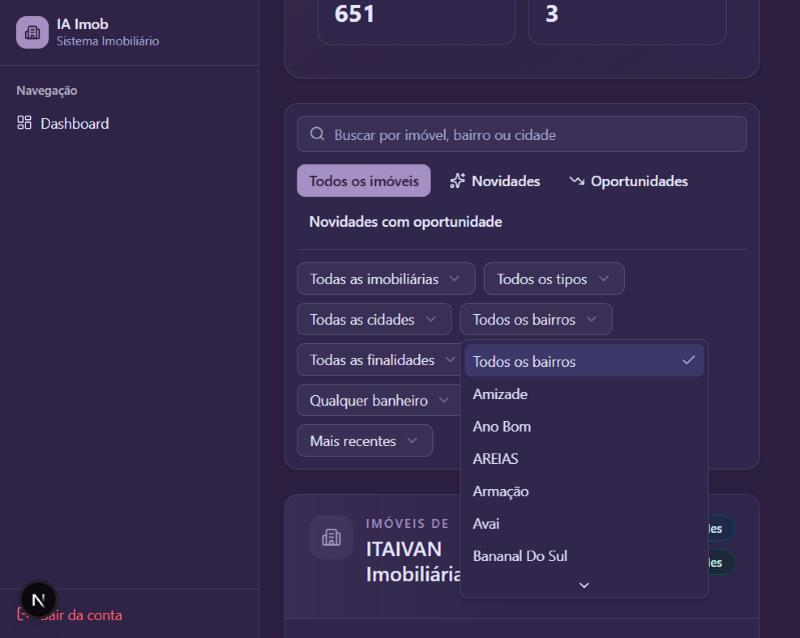

# Evidências — Consolidação e Validação do Módulo de Novos Imóveis

**Entrega:** 05/11/2026

**Descrição da tarefa:** testar as regras, a API e a tela, incluindo anúncios repetidos, falta de informações, acesso de usuários e funcionamento dos filtros.

Validação feita em 02/11/2026 com o sistema rodando localmente (Laravel Sail + Next.js) e a base PostgreSQL restaurada do backup. Os números pertencem a esse backup e mudam após novas publicações do crawler.

## O que foi testado

| Item | Como foi verificado |
| --- | --- |
| Regras do Novo | Janela de 30 dias inclusiva, histórico insuficiente, snapshots não publicados, anúncio conhecido só antes da janela |
| Regras da Oportunidade | Limite exato de 15%, mínimo de 5 comparáveis, faixa de área de 75% a 125%, quartos, finalidade e cada motivo de não classificação |
| Anúncios repetidos | Mesmo anúncio com preço, foto ou URL alterados, anúncio que some e volta, mesma chave em outra imobiliária, nenhum anúncio repetido entre páginas |
| Falta de informações | Sem preço, área, foto, bairro, finalidade, título, localização e link |
| Acesso de usuários | Sem login (401), sem permissão, sem Agência e com Agência inativa (403), e mensagem própria na tela |
| Filtros | Imobiliária, cidade, bairro, tipo, finalidade, quartos, banheiros, vagas, classificação, busca, ordenação, limpeza dos filtros e volta à primeira página |

## Resultado

| Verificação | Resultado |
| --- | --- |
| Testes do módulo no backend | 11 testes e 122 verificações passando |
| Testes do módulo no front | 21 testes passando |
| Testes do front inteiro | 263 de 263 passando |
| Lint dos arquivos alterados | Sem erros |

Testes do módulo: `ai-backendd-imobiliaria/tests/Feature/NewProperties/NewPropertiesQueryServiceTest.php`, `ai-front-end-imobiliaria/src/components/features/new-properties/__tests__/NewPropertiesClient.test.tsx` e `ai-front-end-imobiliaria/src/services/__tests__/newPropertiesService.test.ts`.

## Dados reais

A API retornou 3.584 anúncios, 651 novidades e 3 oportunidades. Percorrendo todas as páginas, os 654 anúncios classificados apareceram uma única vez. Cada filtro de flag, quartos, banheiros e vagas devolveu somente anúncios compatíveis, e a soma por imobiliária também deu 654.

Essa checagem encontrou opções repetidas nos filtros, como "Centro" e "CENTRO". Agora cada valor aparece uma vez: os bairros foram de 84 para 78 opções, e os tipos de 16 para 15. A classificação dos anúncios não mudou.

Capturas anteriores, de 23/09/2026:

- `paginacao.png`: página 2 de 28, com controle para avançar ou voltar.
- `filtros-e-oportunidades.png`: filtros da tela e categoria Oportunidades, com selo, score e justificativa de preço.

## Compatibilidade com a main

O merge com a `main` em `0aea4e1` foi simulado em uma cópia temporária.

| Verificação | Resultado |
| --- | --- |
| Conflitos | `src/config/modules.ts` (manter os dois módulos) e `vitest.setup.ts` (manter a versão da `main`) |
| Migrations em uma cópia da base | Aplicadas sem erro, com os mesmos totais de anúncios, novidades e oportunidades |
| Testes do front inteiro | 352 de 352 passando |
| Build de produção | Passou |
| Testes do backend inteiro | 341 testes, com 30 falhas fora do módulo, as mesmas da `main` sem este código |

Pontos que já existem na `main` e independem deste módulo:

- a migration `2026_11_02_000003_adopt_crawler_neighborhood_catalog` usa `f_unaccent`, que nenhuma migration cria, e por isso falha em um banco novo. Para rodar a suíte, a função foi criada temporariamente no banco `testing`;
- as mesmas 30 falhas do backend aparecem na `main`, nesta branch e no merge simulado. A causa não foi investigada.

As limitações de dados do módulo estão em [CONTEXT.md](../../contexts/new-properties/CONTEXT.md#limitações-conhecidas).
