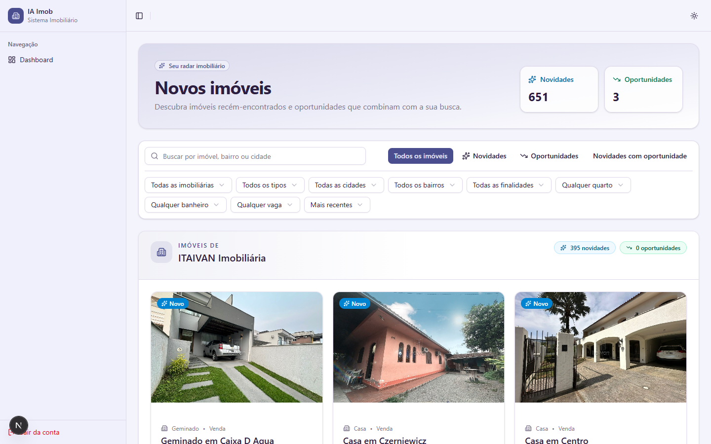
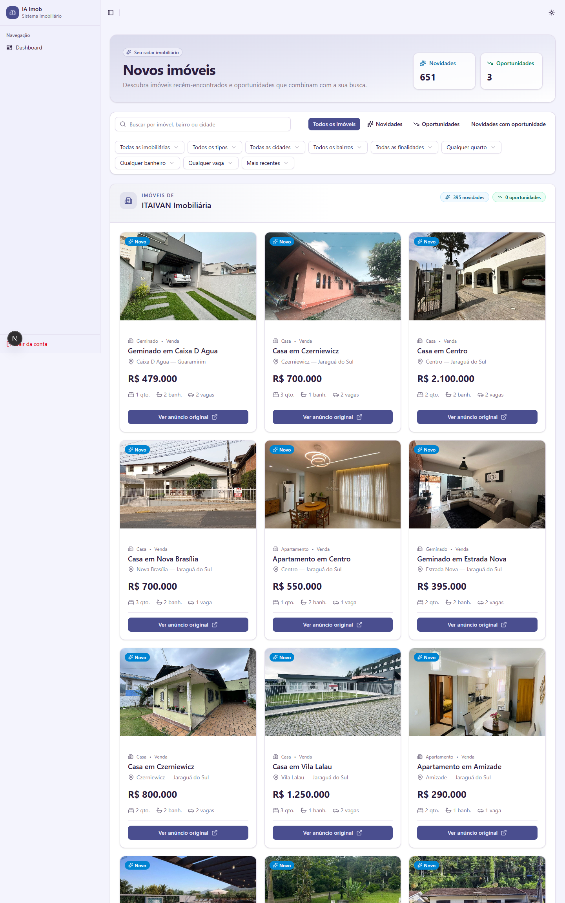
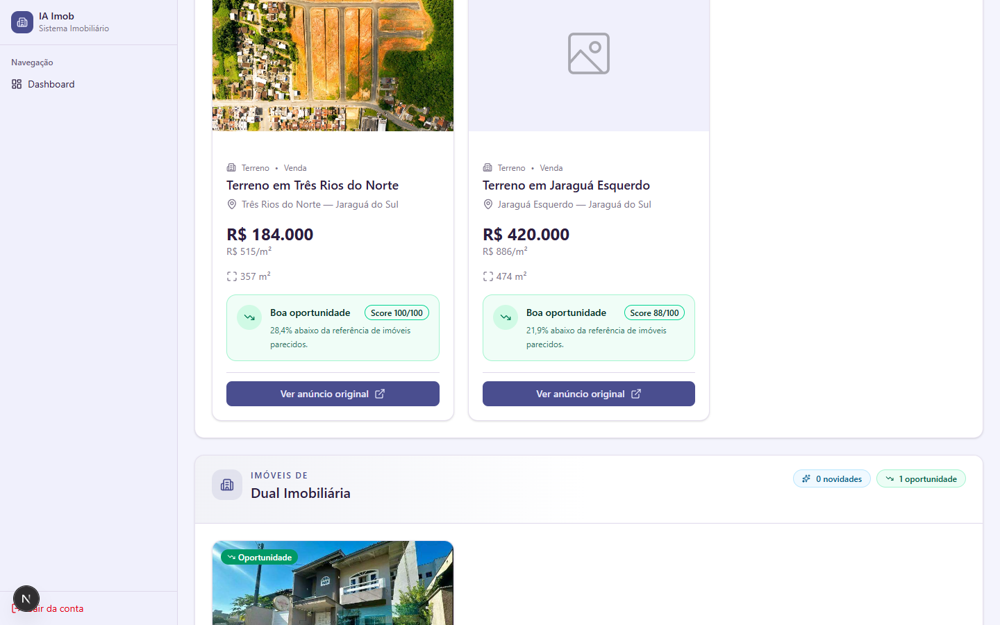
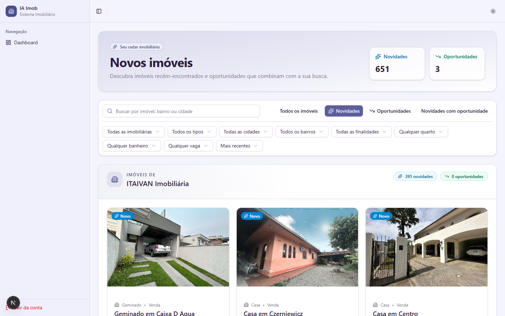
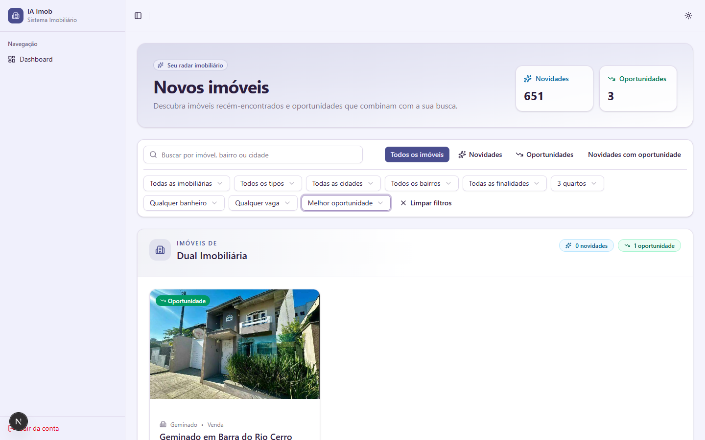
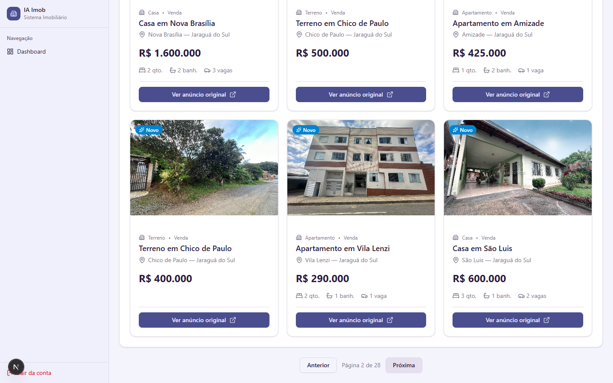

# Evidências — Desenvolvimento da Visualização de Novos Imóveis

**Entrega:** 22/10/2026

**Descrição da tarefa:** criar a tela que organiza os imóveis por imobiliária e mostra fotos, preços, características, selos e score, com busca e filtros.

Capturas feitas em 08/10/2026 na tela `/novos-imoveis`, com o sistema rodando localmente, a base PostgreSQL restaurada do backup e um usuário de teste autenticado. Os números pertencem a esse backup.

| Requisito | Evidência |
| --- | --- |
| Organização por imobiliária | [01](./01-tela-completa.png), [02](./02-agrupado-por-imobiliaria.png) |
| Fotos, preços e características | [02](./02-agrupado-por-imobiliaria.png), [07](./07-paginacao.png) |
| Selos Novo e Oportunidade | [03](./03-oportunidades-selo-e-score.png), [04](./04-novidades.png) |
| Score e justificativa | [03](./03-oportunidades-selo-e-score.png) |
| Busca | [05](./05-busca.png) |
| Filtros e ordenação | [06](./06-filtros-e-ordenacao.png) |
| Paginação | [07](./07-paginacao.png) |

Componentes: `src/components/features/new-properties/NewPropertiesClient.tsx` e `NewPropertyCard.tsx`. Testes: `src/components/features/new-properties/__tests__/NewPropertiesClient.test.tsx`.

## 1. Visão geral

Cabeçalho com o total de novidades e oportunidades, busca, botões de classificação e filtros. Os anúncios aparecem agrupados pela Imobiliária de Origem, com a quantidade de novidades e oportunidades de cada uma.

## 2. Agrupamento por imobiliária e cards

Cada card mostra a foto, o selo, o tipo e a finalidade, o bairro e a cidade, o preço e as características (quartos, banheiros, vagas), além do link para o anúncio original.

## 3. Oportunidades: selo e score

No filtro **Oportunidades**, o card mostra o selo, o preço por m², a área, o **score de 0 a 100** e a justificativa, por exemplo "28,4% abaixo da referência de imóveis parecidos".

## 4. Novidades

No filtro **Novidades**, aparecem somente os anúncios marcados com o selo **Novo**.

## 5. Busca

A busca procura por imóvel, bairro ou cidade. Exemplo: "Caixa D Agua".

## 6. Filtros e ordenação

Exemplo com o filtro **3 quartos** e a ordenação **Melhor oportunidade**. Também há filtros por imobiliária, tipo, cidade, bairro, finalidade, banheiros e vagas, e o botão **Limpar filtros**.

## 7. Paginação

Botões **Anterior** e **Próxima**, com a indicação "Página 2 de 28".

